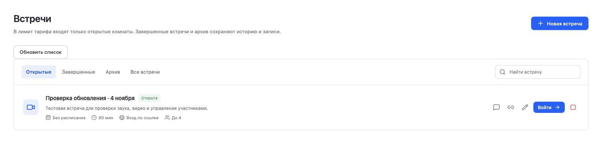

# IMON Meets checkpoint — 2026-11-04

## Current deployment

**The full application release is live on https://meets.imon.world.** The staged cutover reached `live_verified` at **2026-11-04 11:56:18 UTC**. This checkpoint supersedes earlier descriptions of the production version; earlier receipts remain historical evidence.

| Item                                     | Exact identity / status                                                                                                               |
| ---------------------------------------- | ------------------------------------------------------------------------------------------------------------------------------------- |
| Application source                       | `17147a6203814b5ea81de3eea547452496b2a6eb`                                                                                            |
| Production Docker runtime image          | `sha256:5aac16d52549090301e8bc22d2fd423fd33dea986b5796e838680e5817bf2c29`                                                             |
| GitHub `main` application baseline       | Advanced by ordinary non-force fast-forward to `17147a6`; subsequent operator/checkpoint commits preserve its application tree        |
| Existing image-publishing release branch | `release/edge-transport-acme-20261103`, same application commit                                                                       |
| Application/image CI                     | [41812641026 — SUCCESS](https://github.com/IMONsergey/imonmeets/actions/runs/41812641026)                                             |
| Post-fast-forward main CI                | [41825380740 — SUCCESS](https://github.com/IMONsergey/imonmeets/actions/runs/41825380740), exact source `17147a6`                     |
| Operator tooling                         | Code commit `44eaf13d2bb400876c42b861569690e72705b150`; source-assessment documentation at `e3e834519b838b6db0ef3c53c7dbb75102239d5a` |
| Operator tooling CI                      | [41818797347 — SUCCESS](https://github.com/IMONsergey/imonmeets/actions/runs/41818797347)                                             |

The application image was built from application commit `17147a6`. The later operator tooling and this checkpoint do not imply that the application image was rebuilt. The toolchain records the application source and operator code separately.

The [sanitized deployment receipt](docs/release-2026-11-04/full-live-cutover.json) contains the public-safe identities and evidence hashes. Original operational receipts, configuration, database backups, and authority material remain in protected operator custody; they are not reproduced here.

## Google registration and application changes

Google OAuth, email authentication, and registration are enabled in the live configuration. The existing Google OAuth client was inspected in the provider UI with the canonical origin `https://meets.imon.world` and exact redirect `https://meets.imon.world/api/auth/callback/google`. The live OAuth-start response was checked for an `accounts.google.com` destination, the same redirect, identity scopes `openid email profile`, and a secure state cookie.

After the full cutover, the coordinator verified the **Google-authenticated dashboard and its existing workspace**, then created exactly one disposable test room through the normal application UI. The room had four maximum participants, a 60-minute duration, guest access enabled, and the waiting room disabled. This confirms the authenticated application workflow on full source `17147a6`; it does not claim a separate fresh-account signup was repeated after the cutover. The live Security settings also showed the Google connection and offered a separate 15-minute single-use password-setup email flow. That flow was not triggered and no credentials were changed during QA.

The full source includes the secure Google/MFA/identity and mail work, canonical auth-path protection, active-room quota enforcement, waiting cancellation/revocation, RTC admission guards, and the official Google sign-in asset. Closed rooms do not consume active-room quota. The waiting screen clears the persisted grant immediately on cancellation so a reload cannot resume the canceled admission. The full API retains its revocation contract; the temporary narrow release's consumed-ticket limitation is not the deployed contract.

The official PNG sign-in assets are retained with their upstream provenance. The SVG is preserved as a source asset, while the UI uses the PNG and high-density variant for reliable rendering.

_Actual production room-list crop supplied by the coordinator; the account/workspace header, room URL, identifiers, cookies, and account details are excluded. The card confirms room creation and its displayed parameters. The disposable room remains open pending a manual native confirmation; this image is not moderation acceptance._

## Actual cutover and data preservation

The release used three separately reviewed phases: fence and migrate; approve and bind the concrete baseline; restore the actual bound backup before opening traffic. Both canonical and legacy API/RTC entry points were fenced, application and egress writers were stopped, related maintenance was suspended, and active media was empty before the baseline was captured.

An initial attempt stopped at the first fence confirmation before application stop, migration, or binding. Its state and original configuration evidence were retained, and the previous serving configuration was restored and checked. The later reviewed performer waits for an actual completed sweep of four HTTP 503 responses after reload. The original immediate-probe failure is not assigned an unproven root cause.

| Accepted milestone             | Evidence                                                                                                                                            |
| ------------------------------ | --------------------------------------------------------------------------------------------------------------------------------------------------- |
| Concrete fenced baseline       | Created 11:44:27 UTC; SHA-256 `3cc05d3948f25763a13bf00c6bcbcb7246b7b400f7b9cba7fee616bff2e1e101`                                                    |
| Original data across migration | All original columns and rows of 26 tables had identical fingerprints; an independent read-only recomputation matched                               |
| Prospective immutable binding  | Enrolled at 11:49:13 UTC after separate concrete baseline acceptance                                                                                |
| Actual bound backup            | Whole PostgreSQL dump; SHA-256 `a80e8855d5f88bf9d362cef3302355faa0dff3c8d33e8310f397784bff8f50ee`                                                   |
| Actual restore/replay check    | Queue job `20261104T115049-267ba5a95e`, exit 0; all seven gates passed at 11:53:06 UTC                                                              |
| Final runtime acceptance       | Exact image started, health and a fresh canonical checkpoint passed, RTC admission verified, public traffic opened; `live_verified` at 11:56:18 UTC |

The complete fenced inventory was checked privately against the accepted baseline. The public record retains the 26-table preservation and 31-table restore proofs and the hashes of the original evidence, without publishing service volumes or individual account state.

The actual post-enrollment dump was restored into a separate PostgreSQL 17 fixture on an internal network with disposable storage. All columns and rows of all **31 tables**, including the immutable authority binding, its accepted-review hash, and binding time, matched the fenced source. Wrong authority was rejected before witness contact. The same canonical HTTPS witness supplied signed fresh-nonce checkpoints; the unchanged replay implementation completed against version 0 with no deletion intents. All 31 table fingerprints and the read-only journal copy remained unchanged.

This recovery drill executed the unmodified application replay core from source `17147a6` through pinned dependencies. It did **not** execute the immutable application container or the operator replay CLI wrapper. The actual container startup, health, configuration, and fresh checkpoint were checked separately by the final deployment phase before opening. Empty-journal recovery does not substitute for the earlier nonempty synthetic replay tests.

The API-stopped admission probe failed closed. After startup, unauthenticated requests to all four RTC paths on both public RTC endpoints were rejected; management routes remained unavailable publicly. The four existing backup, recording-backup, health, and restore-check timers were restored.

After reopening, the existing local backup service completed once at 12:04 UTC. The new dump contains 31 table definitions, 31 table-data entries, and exactly one binding row matching the canonical approval. The existing encryption workflow also produced its local encrypted companion. This was a catalog and binding verification, not a new restore or decrypt test. The current policy remains **seven-day local retention with no configured offsite upload**; the existing recipient and backup policy were not changed.

Both explicitly identified disposable PostgreSQL fixtures and their isolated networks were removed after acceptance. Their private copied environment, dump, and journal-copy files were removed; the original bound backup, scripts, manifests, fingerprints, and receipts were retained. The production app and canonical metadata were unchanged by that cleanup. A follow-up inventory found that the job launcher also retained environment snapshots for three completed fixture jobs. Those exact snapshots were subsequently removed while preserving request, status, logs, and receipts. The earlier operator assertion that no spool copy existed was corrected; no production credential, runtime, or unit was changed by this cleanup.

## Routine restore-check maintenance

The operator patch extends the routine check from six fixed table counts to the entire observed public-table catalog and a read count from every restored table. It also compares the complete immutable binding, including its timestamp, against the current database and the HMAC-validated canonical local journal. The loader reads the effective installed Compose configuration, resolves the exact host bind, and retains the independent receiver public key needed to validate existing signed acknowledgements. See the [routine restore-check runbook](docs/restore-check.md).

The original patch is `d0cd68e64756f9074280654e68ad9448e9ad0188`, integrated as `878973d1516f087ce07fe582b4767dfaf544269a`. Application code, dependencies, Compose files, and workflow files remain identical to application source `17147a6`.

| Maintenance evidence                  | Confirmed scope                                                                                                                                                                                                                                                                                           |
| ------------------------------------- | --------------------------------------------------------------------------------------------------------------------------------------------------------------------------------------------------------------------------------------------------------------------------------------------------------- |
| Offline regression                    | Queue job `20261104T125518-78d61222db`, eight tests passed; synthetic HMAC, schema/binding/time mismatches, configuration mapping, read-only SQL and shell cleanup failure behavior; Docker was faked                                                                                                     |
| Actual installed-configuration loader | 12:58:15 UTC; final helper bytes resolved the actual main checkout's five Compose layers and read-only canonical journal; metadata unchanged, no database query, receiver request, or unit invocation                                                                                                     |
| Actual restored-copy core             | Queue job `20261104T130627-84920de60b`, exit 0 at 13:06:29 UTC; the complete known 12:04 archive had been restored into a separate bounded PostgreSQL 17 fixture, and all **31** observed tables were readable and matched the captured public catalog; complete binding and local HMAC validation passed |
| Exact fixture cleanup                 | Final reconciliation at 13:10:15 UTC confirmed the own container/network, fixture environments, read-only journal copy, and completed job environment snapshot were absent; production runtime, canonical journal, and original archive were unchanged                                                    |

The actual queued check used the unchanged source verifier with a read-only PostgreSQL adapter connected only to the disposable copy; the production catalog and binding were a pinned read-only capture. It did not invoke the default Docker SQL adapter, scheduled shell/unit, or immutable application image. The loader probe and the restored-copy core are separate evidence. There were no receiver requests, production writes, enrollment, replay, or serving authorization. The current production schema is the reference for this routine; independent application migration completeness, fresh signed checkpoints, and restore-to-serving recovery remain separate gates. Private per-table row counts are not published.

The existing unit reads these scripts from the main checkout, so a fast-forward activates the new routine for its next scheduled run without a unit change. Neither these receipts nor activation alone claim that the complete scheduled service has subsequently run. A post-integration installed-default SQL adapter probe is separate from the pre-integration evidence above. Cleanup retained scripts, manifests, receipts, and job request/status/logs. Its early metadata-guard stop and later successful-deletion wording mismatch were reconciled with a separate read-only absence check; they were not represented as failed core verification or silently discarded.

## Image identity: config digest and runtime digest

The Docker engine exposes an OCI manifest digest as the loaded runtime identity, while the original CI build receipt records the config digest. Both identities were preserved and independently linked through the actual archive.

| Level                                         | SHA-256                                                            |
| --------------------------------------------- | ------------------------------------------------------------------ |
| Loaded OCI manifest / runtime image           | `5aac16d52549090301e8bc22d2fd423fd33dea986b5796e838680e5817bf2c29` |
| Config recorded by the original build receipt | `0969e11b720d59bfafb992a8384581c5cb1ce630e5776edbfe9247eb118c0ddc` |
| Exported image archive                        | `a68ae4bd51608fe0e583986d8f47f8a84b50a0262c2cc002a4504a4b5fc4f2bc` |
| Source archive                                | `89754ff6f4706c7f8e2b550744e0199770828a42043d894450077a471b8c195b` |

The operator verifier hashes the archive, target manifest, config, and every ordered layer, and checks all 13 loaded RootFS diff IDs plus source/platform/runtime identity. It does not accept an arbitrary image-ID override or rewrite the build receipt. The strict legacy same-ID path remains supported. See [containerd image identity](docs/containerd-image-identity.md).

## Canonical witness and recovery boundary

The canonical receiver is available over HTTPS at `witness.imon.world`. Read-only operator observations verified a separate VM endpoint and an actual persistent host-disk bind outside the main application's PostgreSQL backup/restore lifecycle. Its signed checkpoint and metadata continuity were checked after an actual receiver restart.

This proves the scoped separation from the main database restore set. It does not establish separate physical hypervisors, providers, datacenters, or all disaster failure domains. Encrypted authority custody was checked separately; that evidence is not an offsite database/media recovery drill.

**The deployment has crossed the immutable authority-binding boundary.** Any subsequent recovery must retain the same canonical authority and use a compatible full-release image. The old narrow image, pre-binding snapshots, and journal-unaware images are not rollback choices for serving the bound database. Do not reset the authority, copy a binding into older data, or re-enroll a prebaseline restore.

Prebaseline archives are retained for controlled offline investigation and remain ineligible for automatic serving. Archive quarantine is a serving restriction, not proof of historical erasure. No offsite database/media restoration result is claimed by this checkpoint; the local bound-dump drill and encrypted key custody must not be represented as that result.

## Historical limits and remaining acceptance

Three historical `workspace.deleted` events were recorded without target identifiers. A bounded read-only investigation of the nearest available snapshots did not recover the targets. This uncertainty remains explicit: **historical deletion completeness is not established**.

The known two recording targets were checked absent in the actual scoped storage/version reconciliation, with no active recording or pending recording deletion. This does not prove that every unidentified historical workspace or every historical archive is free of deleted data. No identifiers or historical journal intents were invented.

The accepted decision adopts the continuously serving current live database prospectively at the recorded fence. It does not claim the unverified historical workspace-absence item is complete. See the [prospective baseline source assessment](docs/deletion-prospective-baseline-review-20261104.md), [database binding runbook](docs/deletion-database-binding.md), and [journal/restore runbook](docs/deletion-journal-and-restore.md).

The authenticated browser and room-creation checks passed. A production smoke completed at **12:14:14 UTC**: two synthetic browser guests used normal guest grants through the canonical HTTPS/WSS ingress and both showed increasing received-audio byte counters and decoded-video frame counters over a 10-second sample. At the sample end the peers reported 149/147 decoded video frames and 98,835/98,912 received audio bytes; selected routes used UDP. Browser cleanup completed and no unexpected app mutations were observed. The browser HTTP route counter recorded zero blocked GET/HEAD requests outside the approved origins; this is not an audit of UDP, STUN, TURN, or WebSocket traffic. The synthetic media clients used no privileged server credentials. The coordinator also joined through the normal Google-authenticated organizer UI with camera/microphone off and verified the participant-management and end-for-all controls. The separate moderation run and one explicitly authorized bounded retry both stopped at `OWNER_ACK_TIMEOUT` while awaiting the first organizer kick acknowledgement. The received-audio and decoded-video progress checks passed again and both browser cleanups completed, but neither run produced kick, ban, rejoin, or end-for-all acceptance evidence. On the retry the coordinator observed the native confirmation prompt, but the browser-control confirmation handler failed with a focus-emulation transport timeout before acknowledgement. This did not establish a product moderation failure. The fixed deadlines and cleanup guards were retained, and no further automatic retries were made.

The coordinator closed the organizer browser tabs. The disposable room itself remains open and still needs its owner to confirm the normal close action in `/rooms` (the red end button on the test card). Both the room-list and in-call close paths use a native confirmation dialog. The application was not modified to bypass that confirmation or accommodate the browser tool. The final targeted cleanup check found no LiveKit room record, participants, or active egress for this exact disposable room, while its database status remained open. Three media-job environment files and their three completed-job environment snapshots were removed; 34 preserved code/template/status/log/receipt hashes stayed unchanged. Same-host media checks must be labeled separately from external-network/NAT/TURN acceptance. This checkpoint does not certify commercial/public-launch readiness or close all historical deletion, recording, external-network, payment, and offsite recovery acceptance items.

## Continuation rules

1. Start from the exact source/image/main identities above, rather than an older narrow-release checkpoint.
2. Preserve the binding and canonical receiver. Treat recovery after public opening as a separately reviewed forward operation; do not invoke the pre-binding narrow recovery path.
3. Keep original receipts and private material in protected custody. Publish only explicit safe projections, never raw environment files, database rows/dumps, account information, MFA data, or authority capsules.
4. Use the existing job queue for necessary build/test work. Reuse dependencies only after lock-file identity is checked. Operator/docs changes do not require rebuilding the unchanged application image.
5. Finish the specifically unverified acceptance items with authentic evidence; retain unknown history as unknown.
