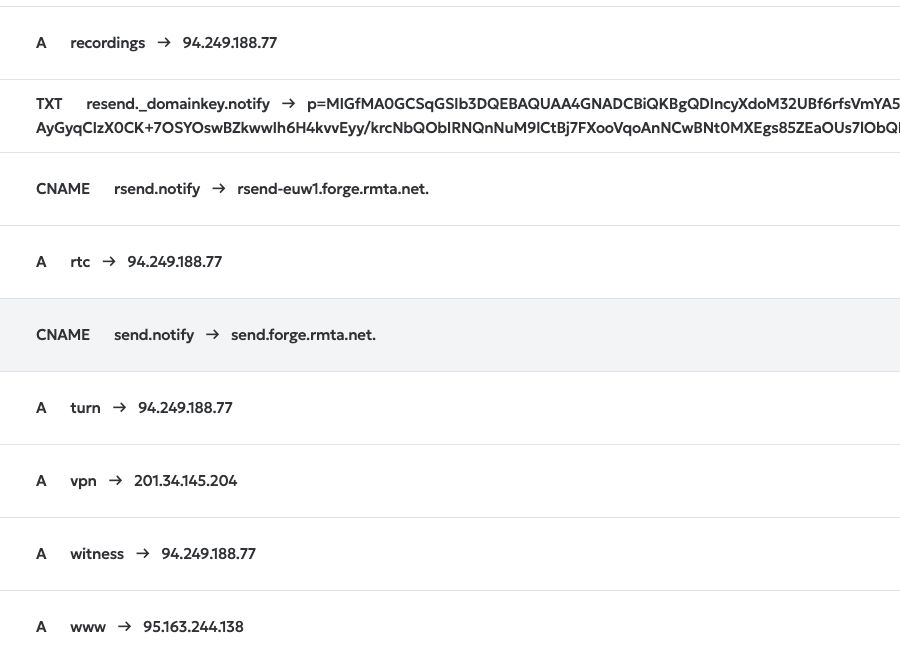

# Edge transport and HTTPS commissioning: 3 November 2026

Status: the dedicated private transport is active, tested and enabled on both hosts. The verified application image is downloaded on main. Four new DNS names resolve authoritatively to edge. Native HTTP bootstrap code passed CI and edge nginx is installed, but the new HTTP units have not been installed or started. Further server commands are paused by the Remote Desktop Commander monthly usage limit. Canonical HTTPS and application cutover remain pending.

This is an operations checkpoint based on immutable release source `05cc907784afe09c156026cc822d3f6bf08bd4c3`. The operations-only branch updates evidence and documentation. It does not change that release, its image, application code, installed transport helpers or the live application.

## Completed

The replacement Google client credential pair was checked against the existing client, canonical origin and callback, then saved in private server staging. It is not active in the old production application. No credential values or downloaded client-secret files are included in this repository. Google policy acceptance is already recorded; a replacement client or another secret download is not needed.

The already purchased edge VPS and main application host now have a dedicated WireGuard peer pair. Inside it, only edge-originated TCP to main ports 5349, 8445 and 18080 is permitted. Both guard services were checked before either link was started. The exact two main UFW allowances were applied. Fresh evidence verified the mutual handshake, endpoints, peer /32 AllowedIPs, source-bound routes and MTU. Existing public/VPN listeners, default and unrelated routes/rules, unrelated firewall state and IP forwarding were preserved.

The separate real-host TCP and stop/restart suite passed all eight checks. Main observed the expected private source on all three permitted ports; an extra listening port and an incorrect source were denied. Stopping only the owned edge transport unit retained the guard and terminal unreachable route. Unbound clients failed closed. Restarting that unit restored all three paths with the correct source. Temporary echo processes and listeners were removed, with no cleanup errors. Main application health returned HTTP 200 and status `ok` before and after this work.

Only `imon-meets-transport.service` was enabled at boot on both hosts. The link and guard services are active, their dependencies are verified and `NoNewPrivileges` remains enabled. No reboot was performed; cold-boot acceptance remains pending.

The application and existing VPN retain their previous deployment. No new IPv4 order or paid service was created during this phase. The existing VPS includes the edge IPv4 used by this design.

## Evidence and limits

| Check | Result |
| --- | --- |
| Transport generator/lifecycle checks | 18 + 5 passed |
| Real disposable WireGuard namespace checks on edge | Second run: 14 passed; cleanup and host-network preservation passed |
| Actual two-host transport | Handshake, three approved TCP paths, denied source/port, unit stop and recovery passed |
| Actual private transport proof | 8 checks passed; temporary listeners removed |
| Transport autostart | Dedicated unit active and enabled on both hosts; cold boot not tested |
| New DNS names | Both authoritative servers return the expected edge IPv4 for rtc, turn, recordings and witness; meets remains on main |
| HTTP/ACME/main bridge/witness/renewal focused checks | 51 passed |
| Native nginx syntax stage | All seven parsed; four full checks returned zero; three edge cases failed on unavailable edge IP binding |
| Native nginx state after fixture attempt | Existing nginx active; public 8443 health HTTP 200; temporary loopback ports absent |
| Integrated CI for exact release source | Run 41680113351 completed successfully, including image publication |
| CI image transfer on main | All nine assets, archive, manifest, image and source identities verified; queued job succeeded |
| Separate native HTTP bootstrap source | 61 focused checks and CI 41687726142 passed; no application source changes |
| Edge nginx prerequisite | Exact two Ubuntu packages installed; stock nginx masked/inactive; no listeners added |
| Native HTTP service deployment | Pending; destination files and units were still absent at the last preflight |
| Application deployment | Previous application still active; new image has not been imported or deployed |

The first namespace attempt failed during bare administrative link recovery. The kernel had removed the active private route. The reviewed recovery repeats only the exact source-bound peer route, preserving the terminal unreachable route and guard. The second attempt passed; the first receipt is retained. Live recovery uses the dedicated unit's normal stop/start.

The native nginx attempt showed that the installed binary can attempt socket binds during `-t`. Its receipt does not claim a non-listening test or operational edge acceptance. No worker cycle, service start or reload was requested; synthetic fixtures were removed. The maintained verifier requires explicit acknowledgement of test binds in an approved context. No further host nginx tests were performed after that observation.

See [transport status](../../verification/edge-transport-candidate-20261103.json), [initial live commissioning](../../verification/edge-transport-commissioning-20261103.json), [real-host TCP and autostart proof](../../verification/edge-transport-live-private-tcp-proof-20261103.json), [certificate checks](../verification/edge-certificates-20261103.json), [native nginx observation](../verification/edge-certificates-nginx-syntax-20261103.json), and [candidate image transfer](../../verification/candidate-image-transfer-20261103.json).

## Verified build and transfer

Release source: [`05cc907784afe09c156026cc822d3f6bf08bd4c3`](https://github.com/IMONsergey/imonmeets/commit/05cc907784afe09c156026cc822d3f6bf08bd4c3).

- [Successful CI run 41680113351](https://github.com/IMONsergey/imonmeets/actions/runs/41680113351).
- [Immutable candidate prerelease and nine assets](https://github.com/IMONsergey/imonmeets/releases/tag/candidate-05cc907784afe09c156026cc822d3f6bf08bd4c3).
- Image ID: `sha256:b6057fb8c0824423dc4825a439a73fb1e8e0f228e9f9dabd0fe0c20328b51ab1`.
- Archive: 110,737,913 bytes; SHA-256 `7f0202c3f1410b78fb6039b8125ffe146078f824cc78e23b92142a4cbba61b84`.
- Transfer manifest SHA-256: `55c9d4167c39c1c580da651021b58e9843468b065ced6615de1e74b5e06b0c25`.

An earlier build submitted through the mandatory main-host job queue failed because its `NoNewPrivileges` policy prevents sudo and the ordinary user cannot access Docker. No queue policy, groups or Docker socket permissions were changed. The old separate privileged controller was not used to bypass the queue.

The accepted release exports the image already built and checked by CI. Its separate publisher validates exact source/image/archive/evidence identities and refuses an existing candidate tag or release. The Git tag and release were read back and match the source above.

Main downloaded the nine public release assets through one ordinary-user job, `20261103T171305-ce4bac91c2`. The job finished successfully at `2026-11-03T17:13:14Z`, with no timeout or disk-reserve breach. The downloader checked every asset's exact size and SHA-256, then ran the exact-source transfer validator. It did not use Docker or root privileges. The downloaded image is ready for the next controlled deployment step; download acceptance does not imply Docker import, application migration or runtime acceptance.

The successful download does not resolve the queue's lack of Docker access. A resource-intensive image import still needs a reviewed path consistent with the mandatory queue and its existing restrictions. Do not infer that the archive is loaded, or repeat the failed privileged build through another launcher.

## DNS preparation

Chrome became available again at approximately `2026-11-03T17:24Z`. Four A records were added through the existing REG.RU zone. The existing meets record and all other records were preserved.

| Name | Authoritative A record | Change |
| --- | --- | --- |
| meets.imon.world | 94.249.186.240 | Preserved on main |
| rtc.imon.world | 94.249.188.77 | Added |
| turn.imon.world | 94.249.188.77 | Added |
| recordings.imon.world | 94.249.188.77 | Added |
| witness.imon.world | 94.249.188.77 | Added |

The first authoritative check at 17:29 UTC still returned NXDOMAIN for the four new names. At `2026-11-03T17:37:22Z`, all ten A queries across `ns1.reg.ru` and `ns2.reg.ru` returned NOERROR, the authoritative flag and exactly the expected address. TTL is 86400 seconds and was not changed. This accepts authoritative publication, not all recursive caches or HTTP/HTTPS serving. See [DNS receipt](../../verification/edge-dns-bootstrap-20261103.json).

## Next action and remaining cutover work

The new Google secret is already privately staged; another client or secret download is unnecessary.

### Native HTTP source is ready; runtime is pending

The separately published operations source is [`e201ea45f088e80877945fa58f28a45f4c22534f`](https://github.com/IMONsergey/imonmeets/commit/e201ea45f088e80877945fa58f28a45f4c22534f), on `feature/native-http-bootstrap-20261103`. Its [CI run 41687726142](https://github.com/IMONsergey/imonmeets/actions/runs/41687726142) completed successfully. The focused suite passed 61 checks, including byte-preservation of all 39 historical full-candidate output files and three complete plans. An independent reviewer recreated those baseline hashes from the original generator.

The explicit HTTP-only generator does not require private secrets or final renewal contexts. It creates two standalone nginx configurations and two dedicated units, with six output files in total plus a nonsecret plan. Main owns only `10.203.77.2:18080` and accepts the actual edge TCP peer. Edge owns `94.249.188.77:80`, forwards only strict challenge paths for main names and serves the witness challenge locally. Both services run as www-data with their own runtime paths and transport dependencies. Shared main nginx and the existing VPN remain independent of the tunnel. There are no TLS includes, Certbot hooks, timers, Docker or application commands in this mode. See the [published native HTTP runbook](https://github.com/IMONsergey/imonmeets/blob/e201ea45f088e80877945fa58f28a45f4c22534f/docs/edge-http-native-bootstrap.md).

The edge package prerequisite completed once at 17:46:37-48 UTC: nginx and nginx-common `1.24.0-2ubuntu7.19`, from official Ubuntu repositories, with no upgrades or removals. Package auto-start was suppressed. The stock nginx service remains masked/inactive; the temporary owned policy file was removed after apt exited. No nginx process or new listener was introduced. Transport guard, route, active/enabled state and handshake were preserved. See [package evidence](../../verification/edge-nginx-package-installation-20261103.json).

The last bounded server preflight at 17:52:00-01 UTC confirmed main webroot traversal/read access for www-data without write access; root ownership, mode 0755 and no symlinks along the exact challenge path; a root-owned Node 24.21.0 runtime; free intended HTTP sockets; and absent new configuration directories, units and staging/worktree paths. Main public 8443 health returned HTTP 200. This preflight did not install or start the new units. The operations commit had not yet been fetched into the proposed main worktree.

After remote command access returns, refresh only the time-sensitive preflight, create a separate exact-e201 operations worktree and regenerate the reviewed hashes. Install only the six corresponding root-owned files, start only the two dedicated HTTP units, then accept real main/edge/witness challenge paths, negative request boundaries, service lifecycle and cleanup. Enable their boot startup only after that acceptance. No shared main nginx reload or general host nginx configuration test is needed. The actual parser runs during the deliberately scoped service start; `nginx -t` must still be treated as a possible bind/listen operation.

Keep the meets A record on main. After HTTP acceptance, separately issue owner-local main and witness certificates, accept protected TLS and prepare the full ingress ownership handoffs. The native main listener must be stopped before the future bridge takes private port 18080; the native edge HTTP listener must be stopped before the full edge nginx takes public port 80. Never run both owners concurrently. None of these runtime or certificate steps has been executed by this checkpoint.

### Server-tool limit

Remote Desktop Commander returned: "You've reached this month's Desktop Commander usage, so tool calls are paused. Your device remains connected and paired — do not retry or reconnect." It points to [usage and reset information](https://mcp.desktopcommander.app/). The rejected action was a bounded read-only ACME account/default-configuration and edge Certbot prerequisite inspection. It returned no PID or execution result; that command did not start.

All server calls stopped at that error. No retry, reconnection or alternate remote-execution route was used. Existing account metadata remains uninspected, edge Certbot was not installed, no account was registered or copied, and no certificate was issued. Restoring the tool's available usage is the immediate continuation prerequisite. It is separate from the application's existing Docker queue restriction.

### Saved continuation and exact boundary

The [final status receipt](../../verification/commissioning-checkpoint-final-20261103.json), [issuance-only plan](certbot-issuance-plan-20261103.json) and [blocked prerequisite receipt](../../verification/certbot-prerequisite-blocked-20261103.json) preserve the execution boundary. The full certificate generator ran in synthetic tests, but it was not used for live issuance.

Unpublished one-off application helpers and their last read-only preflight were retained privately in `IMONMeets_Continuation_Review_20261103.zip`, SHA-256 `ad52acd305939749e88403906e3aea103fe5e146a6eb8726e9d32d1d1bb7c485` (32,706 bytes). The archive contains no credential values or browser screenshots and does not duplicate the published repository source. The deployment helpers were not executed. Python syntax and eleven pure executor ownership/payload/ledger/lock checks passed; complete independent coordinator integration review remains **PENDING**. The published e201 manual runbook remains the reviewed source for the next application step. Do not treat a saved draft helper or a successful CI run as native HTTP, rollback, boot, TLS or application acceptance.

### Application, monitor and data transition

Before changing meets A, review the actual offsite backup/monitor destination. The supported HTTPS puller follows its configured baseUrl and has no resolve/connect-to pin option. If the installed configuration uses meets.imon.world:8443, preserving the old main listener alone will not preserve that path after DNS moves to an edge that serves only ports 80/443. A fresh allowlisted configuration check and explicit monitor transition are required; do not silently fall back to SSH or add an unsupported pin key. Account for the existing 86400-second DNS TTL.

At the controlled application transition, use the immutable source/image above and preserve existing mail/auth credentials and quotas. Reconcile the private runtime staging into the deliberate final environment before activation. Obtain fresh backup/recovery evidence, drain active calls and recordings, retire or guard the exact legacy RTC bypass, update recording-storage CORS as well as application URLs, and prevent the old TURN renewal dispatch from competing with the new certificate writer. Preserve the existing 8443 offsite and health routes.

Independent witness authority, a freshly reviewed writer-fenced legacy baseline, migration/recovery acceptance, canonical Google login and actual external media/long-recording proof remain required. The old `9bb2dab` application cannot resume write-capable operation after deletion-authority enrollment. Registration, billing and other launch switches remain closed until their own acceptance.

Public 443, TURN protocol, PROXY v2 application behavior, cold boot, witness enrollment and commercial readiness are not accepted by the transport proof or by the CI image transfer.
